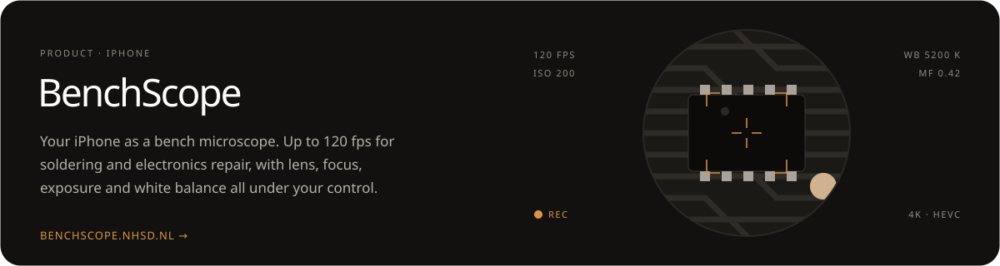
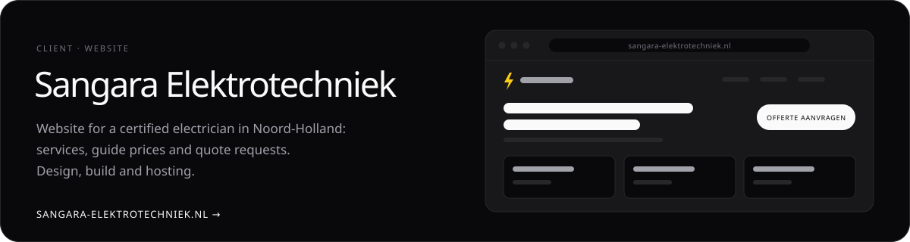
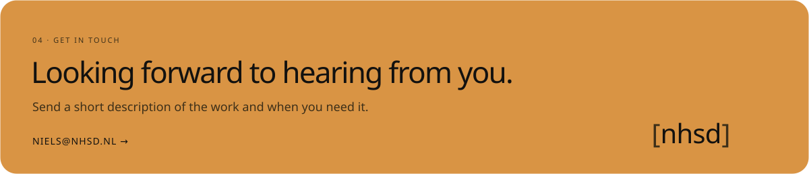

<a href="https://nhsd.nl">
  <picture>
    <source media="(prefers-color-scheme: dark)" srcset="assets/hero-dark.svg">
    
  </picture>
</a>

### 01 · What I take on

**Take on the hard part.** The integration nobody understands any more, the service that falls over every release, code written by people who left long ago. I read my way in, get tests around it and rewrite the parts that keep causing trouble, until your team can touch it again without holding its breath.

**Build it from zero to live.** From empty repository to running service: interface, API, database, deployment and the pipeline that keeps it shipping. One person across the whole stack, so nothing falls through the cracks and nobody is waiting on anyone else.

**Keep a team on track.** Eight years as a lead developer. Code review, architecture decisions and helping colleagues along, next to the building itself. If there is no product owner, I take on that role too.

### 02 · Products and clients

### 03 · Experience

| Company | Role | Period |
| :--- | :--- | ---: |
| **Wij Techniek** | Software Developer | Mar 2026 → now |
| **Inter IKEA Systems** | Full Stack Developer | 2023 – Dec 2025 |
| **GrandVision N.V.** | Backend Developer | 2021 – 2023 |
| **Governance** | Lead Software Developer | 2013 – 2021 |
| **JUNO Facility Performance** | Software Developer | 2007 – 2013 |

And before that, at home on an Amiga 500.

  <a href="mailto:niels@nhsd.nl">niels@nhsd.nl</a> ·
  <a href="https://nhsd.nl">nhsd.nl</a> ·
  <a href="https://www.linkedin.com/in/nielsheisterkamp/">LinkedIn</a>
   
  Niels Heisterkamp Software Development B.V. · Hillegom, NL · KvK 94274150

